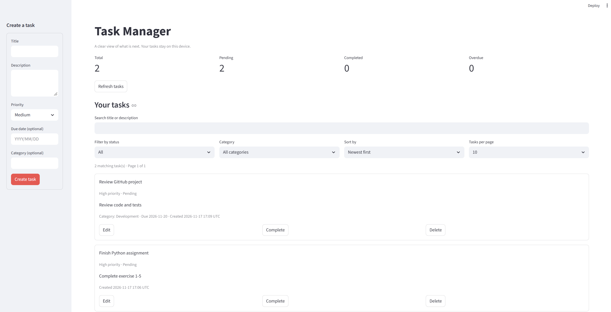

# Task Manager

A lightweight task management app built with Python, Streamlit, and SQLite. Organize tasks, track deadlines, and manage priorities through a simple dashboard.

## Application screenshot



## Key features

- Create, edit, complete, and reopen tasks; confirm before deletion.
- Assign priorities, categories, and optional due dates.
- Search, filter, sort, and browse tasks in pages.
- View total, pending, completed, and overdue counts.
- Keep tasks in a local database with automatic schema migrations.
- Detect stale edits and require review before deleting changed tasks.

## Tech stack

Python 3.12, Streamlit, SQLite, pytest/AppTest, pytest-cov, Ruff, and GitHub Actions.

## Quick start

Use Python 3.12 and run these commands from the repository root.

**Windows PowerShell**

```powershell
python -m venv .venv
.\.venv\Scripts\python.exe -m pip install -r requirements-dev.lock
.\.venv\Scripts\python.exe -m streamlit run app.py --server.address 127.0.0.1
```

**macOS / Linux**

```sh
python3.12 -m venv .venv
.venv/bin/python -m pip install -r requirements-dev.lock
.venv/bin/python -m streamlit run app.py --server.address 127.0.0.1
```

Open the Local URL printed in the terminal, normally `http://localhost:8501`.
Stop the server with Ctrl+C. No account, API key, or separate SQLite install is needed.

Tasks are stored in `data/tasks.db` beside `app.py`. **Before upgrading an existing
database, stop all app instances and make a backup.** See the
[upgrade and backup instructions](docs/USAGE.md#upgrades-and-backups).

## Testing

After setup, run from the repository root in PowerShell:

```powershell
.\.venv\Scripts\python.exe -m pytest
```

On macOS/Linux, use `.venv/bin/python` instead. Tests use temporary databases.
See the [development guide](docs/DEVELOPMENT.md) for linting, formatting, coverage,
CI, and dependency updates.

## Documentation

- [Usage and operations](docs/USAGE.md): dashboard, configuration, backups, and limitations.
- [Architecture and service API](docs/ARCHITECTURE.md): contracts, migrations, and concurrency.
- [Development guide](docs/DEVELOPMENT.md): tests, quality gates, CI, and dependencies.
- [V2 implementation record](docs/IMPLEMENTATION_PLAN.md): completed work and historical verification.

## Scope and security

Designed for local or small trusted-team use on one host. There is no authentication
or per-user task isolation: anyone who can reach the server shares the same list.
Keep it bound to loopback for local use; do not expose it publicly as-is.
[Operational limits and security guidance](docs/USAGE.md#limitations-and-security).

## License

Licensed under the [MIT License](LICENSE).
